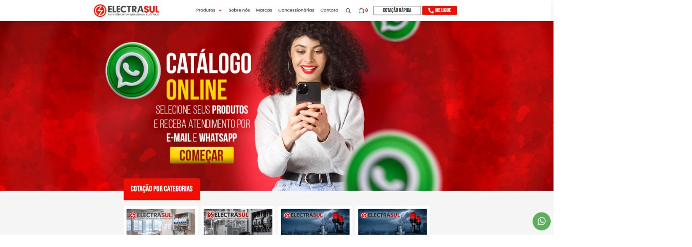

# Site institucional para desenvolvedor freelancer

Landing page completa para apresentar serviços, portfólio e captar clientes. Feita à mão, sem template.



## Destaques

- **Design próprio:** tokens de cor e tipografia, animações de entrada e efeito de luz no cursor
- **Acessível:** respeita `prefers-reduced-motion`
- **Formulário de contato real:** API serverless na Vercel gravando os leads no Supabase
- **Seguro:** validação no servidor, limite de tentativas por IP e honeypot contra bots
- **Leve:** HTML, CSS e JavaScript puros, sem framework no front

## Seções

Serviços · Projetos no ar · Sobre · Processo (briefing → proposta → desenvolvimento → entrega) · Contato

## Stack

HTML5 · CSS3 · JavaScript · Node.js (Vercel Functions) · Supabase

## Rodar localmente

```bash
npm install
cp .env.example .env   # preencha SUPABASE_URL e SUPABASE_SERVICE_ROLE_KEY
npm run dev            # vercel dev
```

## Estrutura

```
api/contact.js     endpoint do formulário
lib/supabase.js    cliente do Supabase
css/style.css      estilos e design tokens
js/main.js         interações e animações
assets/            logo e previews
```

---

Desenvolvido por [Alisson Mendes](https://github.com/devMendes23)
